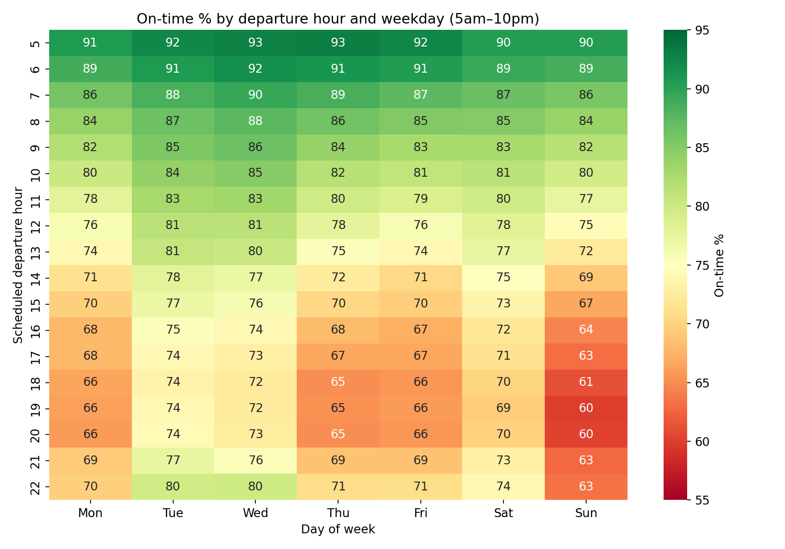

# Flight Delay Analysis

**One-line pitch:** Which airlines, airports, routes, and times of day cause the most flight delays — and how much of it is actually the airlines' fault?

**Business question:** Which airlines, airports, routes, and times of day cause the most delays, and how much is controllable (carrier) vs. uncontrollable (weather)?



## Key findings

- **Delays build through the day.** On-time performance falls from **91.7% on 5am departures to 67.3% by 7pm**, and Sunday evenings are the worst slot in the week (60–63% on time). The first flights of the day start clean; delays cascade as aircraft and crews run late.
- **Most delay is airline-controllable, not weather.** Of delay minutes on delayed flights, **late aircraft (39.8%) and carrier issues (32.9%) drive 72.7%**; NAS is 21.1% and weather only **6.0%**. Late aircraft shows up in **52.2% of all delayed flights** and is the single largest cause for 40.1% of them.
- **Delta is the most reliable large airline (81.1% on time); JetBlue is the worst (71.3%).** Regional carriers cancel far more often — PSA 4.8%, Republic 4.6% — vs Allegiant 0.7% and Southwest 0.9%.
- **San Francisco is the delay capital.** SFO arrivals run only **66.3% on time** (23.3 min average delay) and **6 of the 10 worst routes end at SFO** (worst: San Luis Obispo–SFO, 56.4% on time). Salt Lake City is the most reliable large airport (84.5% on time), and its routes dominate the best-10 list.

Overall, of **7,049,869 scheduled flights (Sep 2025–Aug 2026)**, **77.3% arrived on time** (under 15 minutes late), **22.7% were delayed 15+ minutes**, and **1.9% were cancelled**. The average arrival delay was 17.6 minutes, but the median was 0 — most flights arrive early or on time, and a long tail of badly delayed flights pulls the average up. When a flight is delayed, it is delayed by **73 minutes on average**. Total delay time across delayed flights: **~1.91 million hours**.

## Data source and size

- **Source:** US Bureau of Transportation Statistics (BTS), TranStats, On-Time Performance table (1987–present), monthly CSVs from [transtats.bts.gov](https://www.transtats.bts.gov/) (`PREZIP/On_Time_Reporting_Carrier_On_Time_Performance_1987_present_YYYY_M.zip`).
- **Coverage:** September 2025 – August 2026, the most recent 12 months available (September 2026 had not been published when the data was pulled on 18 Nov 2026).
- **Size:** 7,049,869 rows, one per scheduled domestic flight; 14 airlines; 360 airports; 12 monthly files, ~356 MB zipped.
- **Lookups:** Airport names/cities come from the OTP file itself. Airline full names are the BTS-published names for the 14 IATA codes in the data (`data/airlines.csv`); the TranStats lookup endpoint redirects to the homepage for direct downloads, so the lookup CSVs could not be fetched with curl (see `notes/cleaning_notes.md`).

## Tools used

- **DuckDB** — loading, cleaning, and all analysis (SQL with CTEs and window functions)
- **SQL** — 16 queries across `sql/02_metrics.sql` … `sql/08_cancellations.sql`
- **Python (pandas, matplotlib, seaborn, scikit-learn)** — EDA notebook, charts, stretch delay-prediction model
- **HTML** — static dashboard (`dashboard/index.html`); spec for a Power BI / Tableau build in `dashboard/DASHBOARD_SPEC.md`

## Approach

1. **Load** the 12 monthly CSVs into DuckDB (`sql/01_load.sql`, run via `python3 load.py`). Raw files are git-ignored; the database rebuilds from the script.
2. **Clean** — cancelled and diverted flights are flagged and kept out of delay metrics (cancellation rate is measured separately); scheduled HHMM times are converted to a departure hour; delay-cause NULLs are treated as 0 minutes attributed. Every decision is documented in `notes/cleaning_notes.md`, with QA checks in `load.py`.
3. **Define metrics** — on-time % (arrival delay under 15 min), average delay minutes, cancellation rate, and share of delay by cause.
4. **Analyze in SQL** — 10 questions: worst/best airlines, airline rank within each airport (window function), busiest airports and their delay rates, delay by hour/day/month, worst 10 routes (1,000+ flights), cascading late-aircraft delays, cause shares, and cancellations.
5. **Visualize** — heatmap of delays by hour and weekday, distribution and seasonality charts (`notebooks/01_eda.ipynb`, charts in `images/`).
6. **Stretch model** — logistic regression predicting a 15+ minute delay. Schedule-only features (airline, hour, weekday, month, distance) barely predict it (ROC-AUC 0.65); adding departure delay lifts it to ROC-AUC 0.92 — a late departure is the single best predictor of a late arrival, which matches the late-aircraft cascade finding.

## Recommendations

- **Fly early.** Departures before 9am run 83–92% on time; after 6pm it drops to about 67%.
- **Avoid SFO for connections**, especially in the evening — 6 of the 10 worst routes end there, and SFO arrivals run only 66.3% on time.
- **Prefer Delta or Alaska** for reliability (81% / 80% on time). Budget carriers trade price for punctuality (JetBlue 71%, Spirit 72%, Frontier 73%).
- **Build buffer time on multi-leg trips.** Late aircraft causes 39.8% of delay minutes and appears in 52.2% of delayed flights — one late plane cascades through the day.
- **Avoid Sundays and July** when the schedule allows (73.0% and 71.7% on time, respectively).

## Repository structure

```
flight-delay-analysis/
├── README.md
├── load.py                # builds data/flights.duckdb from the CSVs + QA checks
├── run_analysis.py        # runs sql/02–08, saves dashboard/*.csv
├── .gitignore
├── data/
│   ├── airlines.csv       # IATA code -> BTS carrier name (14 carriers)
│   ├── raw/               # monthly CSVs (git-ignored, 3 GB)
│   └── flights.duckdb     # built database (git-ignored)
├── sql/
│   ├── 01_load.sql        # raw load + cleaned tables + dimensions
│   ├── 02_metrics.sql     # overall KPIs
│   ├── 03_airlines.sql    # airline ranking + rank within airport
│   ├── 04_airports.sql    # busiest airports and delay rates
│   ├── 05_time.sql        # hour / weekday / month
│   ├── 06_routes.sql      # worst + best routes
│   ├── 07_causes.sql      # delay causes, cascades, controllability
│   └── 08_cancellations.sql
├── notebooks/
│   ├── 01_eda.ipynb       # EDA with embedded charts
│   └── build_notebook.py  # regenerates the notebook + charts
├── dashboard/
│   ├── index.html         # static dashboard (open in a browser)
│   ├── DASHBOARD_SPEC.md  # Power BI / Tableau build spec
│   └── *.csv              # query outputs backing the dashboard
├── images/                # charts (heatmap, hour, seasonality, airlines, causes, distribution)
└── notes/
    └── cleaning_notes.md  # every cleaning decision + QA results
```

## How to reproduce

```bash
git clone https://github.com/Saikrishna-469/flight-delay-analysis.git
cd flight-delay-analysis
pip install duckdb pandas matplotlib seaborn scikit-learn nbformat

# 1. Download the data (12 monthly zips, Sep 2025 – Aug 2026, ~356 MB)
mkdir -p data/raw
cd data/raw
for ym in 2025_9 2025_10 2025_11 2025_12 2026_1 2026_2 2026_3 2026_4 2026_5 2026_6 2026_7 2026_8; do
  curl -O "https://transtats.bts.gov/PREZIP/On_Time_Reporting_Carrier_On_Time_Performance_1987_present_${ym}.zip"
  unzip -o "On_Time_Reporting_Carrier_On_Time_Performance_1987_present_${ym}.zip"
done
cd ../..

# 2. Load into DuckDB (builds data/flights.duckdb, runs QA checks)
python3 load.py

# 3. Run the analysis (prints results, saves dashboard/*.csv)
python3 run_analysis.py

# 4. Rebuild the notebook and charts
python3 notebooks/build_notebook.py

# 5. Open the dashboard
open dashboard/index.html
```

## Limitations

- **12 months only** (Sep 2025–Aug 2026), so year-over-year comparisons are not possible; September 2026 was not yet published.
- **Weather is a BTS attribution, not matched conditions.** Cause minutes are the BTS's own attribution; "weather caused 6.0% of delay minutes" means the BTS coded it that way, not that weather was independently verified.
- **Controllable vs uncontrollable is a judgement call.** Carrier + late aircraft are grouped as airline-controllable, NAS + security as system-level, weather as uncontrollable; reasonable people could group NAS differently.
- **Domestic scheduled flights only.** No international, charter, or cargo flights.
- **Delay-cause minutes are attributions, not a causal model.** A flight can have several contributing causes; BTS splits its arrival delay across them.
- **Two carriers disappear mid-window.** Spirit (NK) stops reporting after early 2026 and Hawaiian (HA) after the Alaska merger integration, so their figures cover only part of the 12 months; do not compare their totals with full-year carriers.
- **The stretch model is illustrative.** Schedule-only features predict delays poorly (ROC-AUC 0.65); the model is included to show that, not as a production predictor.
